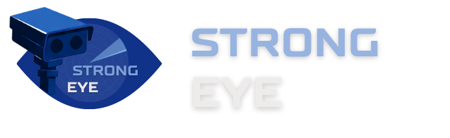

O **Strong Eye** é um sistema de monitoramento contínuo e em tempo real para hardware de radares eletrônicos (CPU, RAM, Disco e Rede). O objetivo é identificar gargalos e prever falhas antes que elas interrompam a fiscalização viária.

## 🚀 Funcionalidades Principais

* **Monitoramento em Tempo Real:** Visão geral da saúde dos radares (Status: Problema, Atenção e Funcionando).
* **Alertas Inteligentes:** Integração com Slack para notificação automática da equipe sobre radares sobrecarregados.
* **Gestão de Manutenção:** Acompanhamento de chamados abertos e técnicos em campo por região.

## 🛠️ Tecnologias Utilizadas

* **Captura & Segurança:** Python (rodando em instâncias AWS EC2).
* **Processamento de Logs:** Aplicação Java (.JAR).
* **Banco de Dados:** MySQL.
* **Backend:** Node.js.
* **Frontend:** HTML5, CSS3, Bootstrap e Chart.js.
* **Infraestrutura:** AWS (Data Lake / EC2).
* **Comunicação:** Slack API.

## 👥 Equipe

* Kevin Johann
* Lucas Gonçalves
* Lucas Yugui
* Milena Amorim
* Murilo Mendes
* Rafaela Leite
